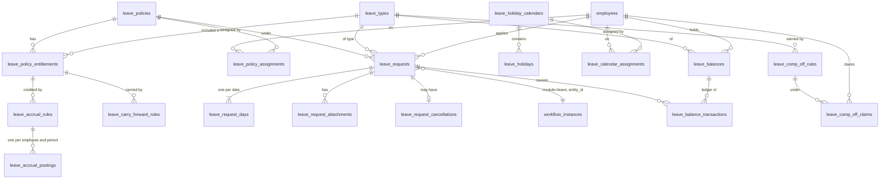

# Leave Management

How the module is built and how to run it. For engineers and whoever operates the system.

## Upgrading: old leave data is deleted

Migrations `011`–`014` **replace** the first Leave Management implementation. This is not a data migration.

| Removed for good | Kept |
|---|---|
| All leave requests | Employees, users, departments, reporting lines |
| All leave balances and their transaction history | Roles and assignments (old leave permissions are mapped to new ones) |
| All leave types | Workflow definitions, published versions and history |
| All holidays | Everything in other modules |

In-flight leave workflows are closed as `cancelled`, with an entry in their history. Unsent notifications about the removed requests are marked as skipped.

Only a backup can bring the old data back. `npm run db:migrate` takes one automatically.

### Applying the migrations

```bash
# A database created before db:migrate existed: record what it already has, and look first.
npm run db:migrate -- --baseline 010 --status

# Dumps the database to backups/ (because 011 is marked @destructive), then applies 011-015.
npm run db:migrate -- --baseline 010
```

Migration `015` (comp off claims through the workflow engine) only adds to the schema. After it, **publish a comp off approval workflow** under Approval Workflows → Comp off claims: "Copy steps from the leave workflow" does it in one click. Until one is published, employees can't submit comp off claims that need approval.

Later runs need only `npm run db:migrate`. If the dump fails, nothing is applied. Each migration runs in its own transaction. `pg_dump` is found through `PG_BIN`, `PATH` or the default Windows install folder. `backups/` is git-ignored, and it holds password hashes and personal data, so keep it private.

To restore:

```bash
pg_restore --clean --if-exists --dbname=<database> backups/<file>.dump
```

After migrating, **HR must set up the module**: leave types, a policy with entitlements, accrual rules and a holiday calendar. Employees see "no leave types available" until then. Run `npm run db:reset` for sample data on a development database.

## Data model



`leave_audit_log` records configuration changes and HR actions. Every table has `tenant_id`, composite tenant-aware foreign keys, and forced RLS with a `tenant_isolation` policy.

## The balance ledger

The ledger is the source of truth. `leave_balances` is a projection that only a database trigger can change: the API role has `SELECT` and a column-limited `INSERT` on it, and no way to set a bucket. `available` is a generated column.

| Event | Transaction | Bucket |
|---|---|---|
| Submit | `LEAVE_HOLD` | pending + |
| Final approval | `LEAVE_HOLD_RELEASE`, `LEAVE_CONSUMPTION` | pending −, used + |
| Reject, withdraw | `LEAVE_HOLD_RELEASE` | pending − |
| Return for information | none | the hold stays |
| Cancel approved leave | `LEAVE_REVERSAL` | used − |
| Accrual job | `ACCRUAL` | accrued + |
| Comp off claim fully approved | `COMP_OFF_CREDIT` | comp_off + |
| HR adjustment | `MANUAL_CREDIT`, `MANUAL_DEBIT` | adjusted ± |
| Encashment | `ENCASHMENT` | encashed + |
| Closing a year | `CARRY_FORWARD_OUT`, `CARRY_FORWARD`, `EXPIRY` | carried_out + (old year), carried_forward + (new year), expired + |
| Credit passes its date | `EXPIRY` | expired + |

`OPENING_BALANCE` is reserved for loading balances from another system. No API posts it today.

**Holds are not deductions.** Submitting never touches `used`. A hold reduces `available`, which is what stops two pending requests from spending the same days.

**Safety:**
- Every row has a deterministic `idempotency_key`, unique per tenant. A retried approval, accrual or reversal posts nothing.
- Requests lock the balance row (`FOR UPDATE`) before checking it, so concurrent requests see each other's holds.
- An exclusion constraint refuses overlapping requests even in a race. It works in half-day slots, so a morning and an afternoon half day on one date can coexist.
- `v_leave_balance_drift` compares every bucket with the ledger and should always be empty. The Reports page shows its status.
- Lock order on every path: `workflow_instance → leave_request → leave_balance`.

## Workflow integration

Leave uses the existing engine with no new workflow tables. `entity_type = LEAVE_REQUEST` from the brief is the engine's `module = 'leave'` plus `entity_id`.

- **Hooks** (`leave.workflow-handler.ts`) run inside the engine's transaction, so "approve" and "deduct" commit or roll back together.
- **Actions** use the engine's `POST /workflows/tasks/:id/approve|reject|return`. It checks ownership, the current step and cycle, delegation, separation of duties and permissions. "Request information" is `return`.
- **One engine addition:** an optional `actionPermission` on the handler, so `leave.request.reject` and `.return` apply on those generic endpoints too.
- **Comp off claims** are a second engine module, `comp_off`, with their own published definition (Approval Workflows → Comp off claims). A claim reaches whoever its steps name, usually the reporting manager and then HR; final approval credits the days in the same transaction. Approvers act on claims from the same Pending Approvals list as leave. A claim can be returned for information and resubmitted, or withdrawn. If the comp off rule doesn't require approval, a claim is credited straight away with no workflow.
- **Conditions** for leave can use `totalDays`, `leaveTypeCode`, `leaveCategory`, `isPaid`; for comp off, `hoursWorked`, `earnedDays`, `workDayType`, `leaveTypeCode`. Both can use `employmentType`, `departmentId`, `departmentName`, `managerEmployeeId`.
- **Delegations** are per engine module: a delegation for `leave` doesn't cover `comp_off` claims. Create it for all modules to cover both.
- **Notifications** go through the outbox: `leave.submitted`, `.approved`, `.rejected`, `.returned`, `.withdrawn`, `.cancelled`, `leave.comp_off_claimed`, `.comp_off_approved`, `.comp_off_rejected`, `.comp_off_returned`, plus the engine's `workflow.*` events. The worker currently logs them; connecting email or push is still to do.

## Permissions

| Audience | Codes |
|---|---|
| Employee | `leave.dashboard.view_self`, `leave.request.create_self`, `.view_self`, `.cancel_self`, `leave.balance.view_self`, `leave.calendar.view_self` |
| Manager | `leave.dashboard.view_team`, `leave.request.view_team`, `.approve`, `.reject`, `.return`, `leave.approval_history.view_team` |
| HR Admin | `leave.dashboard.view_all`, `leave.request.view_all`, `.manage`, `leave.calendar.view_all`, `leave.reports.view`, `leave.configuration.view`, `.manage`, `leave.policy.assign`, `leave.balance.adjust` |

The Approval Workflows page also needs `workflow.view` or `workflow.configure`. Migration `014` gives each role the new codes for what it held:

| Old | New |
|---|---|
| `leave.create` | `leave.request.create_self` |
| `leave.view.own` | `leave.dashboard.view_self`, `leave.request.view_self`, `leave.balance.view_self`, `leave.calendar.view_self` |
| `leave.withdraw` | `leave.request.cancel_self` |
| `leave.view.team` | `leave.dashboard.view_team`, `leave.request.view_team` |
| `leave.approve` | `leave.request.approve`, `.reject`, `.return`, `leave.approval_history.view_team` |
| `leave.view.all` | `leave.dashboard.view_all`, `leave.request.view_all`, `leave.calendar.view_all`, `leave.reports.view` |
| `leave.type.manage` | `leave.configuration.view`, `.manage` |
| `leave.balance.manage` | `leave.configuration.view`, `leave.balance.adjust`, `leave.policy.assign`, `leave.request.manage` |

Permissions say what kind of action is allowed. The services also enforce whose data: a request outside your scope is a 404. Team means the `employee_reporting` subtree as of today, plus requests with a task assigned to or acted on by you. Nobody can approve, verify, adjust or use an HR action on their own record.

## Rules and how they resolve

**Policy for an employee on a date:** their effective assignment, otherwise the active default policy.

**Holidays for an employee on a date:** the calendar assigned to them, otherwise an active calendar whose `location` matches their `work_location`, otherwise the default calendar for that year. Resolved per date, so a transfer takes effect on its date. Optional holidays are still charged. Submitted requests keep their days in `leave_request_days`, so editing a calendar later doesn't change them.

**Half days and consecutive-day limits:** the leave type and the policy entitlement combine. A policy can restrict half days but not grant them where the type forbids them. A policy limit on consecutive days overrides the type's.

**Accrual:** credits each due period of the current leave year once. A period the maximum balance capped is recorded as used, so it isn't credited later. Prior years aren't back-filled. Only `annual`, `monthly` and `quarterly` use the proration and new-joiner settings.

**Carry forward:** moves up to the limit into next year and lapses the rest. Requests still pending at close return their days to the old year if rejected; the preview warns about this.

**Expiry:** first-in-first-out. Used and held days come off the oldest credits first, and only the unused remainder expires. A credit is valid through its expiry date.

**Rule changes:** active rules can't be edited. Archive and create a new one. Past ledger rows are never rewritten.

## Scheduled jobs

Run daily from cron or a task scheduler. Safe to repeat, and one tenant failing doesn't stop the others (the exit code reports it).

```bash
npm run leave:jobs -- daily                          # accrual, expiry, removal of abandoned uploads
npm run leave:jobs -- carry-forward --from-year 2026 # once, early in the new year
npm run leave:jobs -- accrual --dry-run              # any job can preview
```

HR can run the same jobs from **Accrual & Carry Forward**, always previewing first.

## API

All under `/api/v1`, using the existing error format. `Idempotency-Key` (a UUID) is honoured on request creation and balance adjustments.

| Path | Purpose |
|---|---|
| `GET /leave/dashboard`, `/leave/types`, `/leave/balances`, `/leave/balances/transactions`, `/leave/calendar` | Employee |
| `POST /leave/requests/preview`, `POST /leave/requests`, `GET /leave/requests[/:id]`, `POST /leave/requests/:id/resubmit\|withdraw\|cancel` | Employee requests (detail is scope-checked for everyone) |
| `POST /leave/attachments?fileName=`, `GET\|DELETE /leave/attachments/:id` | Documents: raw bytes, 5 MB, PDF/PNG/JPEG/WebP checked by content |
| `GET /leave/comp-off/types`, `GET\|POST /leave/comp-off/claims`, `POST /leave/comp-off/claims/:id/resubmit\|withdraw` | Comp off claims (decided through the engine's task endpoints) |
| `GET /leave/team/dashboard`, `/members`, `/requests`, `/approvals/pending`, `/approvals/history` | Manager |
| `GET /leave/admin/dashboard`, `/requests`, `/calendar`, `/balances`, `/reconciliation`, `/reports/:type`; `POST /requests/:id/cancel` | HR |
| `POST /leave/admin/balances/adjust\|encash`; `POST /leave/admin/jobs/accrual\|carry-forward\|expiry` | Balances and jobs (jobs default to a dry run) |
| `GET /leave/admin/comp-off/claims` | Every claim, with its approval stage (read-only) |
| `/leave/config/types`, `/policies`, `/entitlements`, `/holiday-calendars`, `/holidays`, `/policy-assignments`, `/calendar-assignments`, `/employee-assignments`, `/accrual-rules`, `/carry-forward-rules`, `/comp-off-rules`, `/workflow-options` | Configuration |
| `GET /leave/lookups`, `/leave/employees` | Filter and picker data |

Report types: `balance`, `department`, `utilization`, `leave_type`, `monthly`, `annual`, `pending`, `accrual`, `carry_forward`, `encashment`, `audit`.

## Known limits

- **Leave year = calendar year.** A request can't span two years; split it. `tenant_settings.financial_year_start_month` isn't used.
- **Half days are single-date.** A multi-day request can't start or end on a half day.
- **No location master exists.** Calendars match `employees.work_location` text, so a spelling difference means no match.
- **Cancelling approved leave has no approval step.** Employees can do it before the start date; after that it's HR.
- **Comp off approvers check the worked hours by hand,** because there's no attendance module to verify against. A claim credits the balance of the year it's approved in.
- **Encashment only debits the balance.** Paying it is left to payroll, which doesn't exist yet.
- **`entitlement_unit` is days only.**
- **A resubmitted request keeps its dates.** To change dates, withdraw and apply again.
- **No SLA escalation job.** Overdue tasks are flagged. The engine's on-submit fallback role is the only automatic escalation, as before this module.
- **Accrual and carry-forward run in one transaction per tenant.** Fine for typical tenant sizes; very large tenants may need batching.
